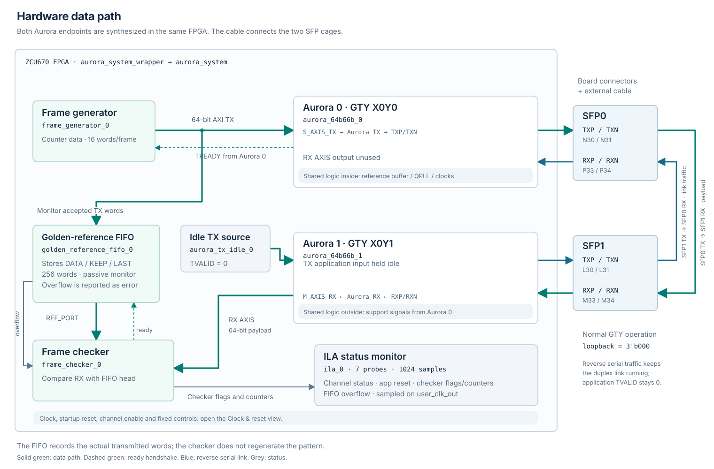
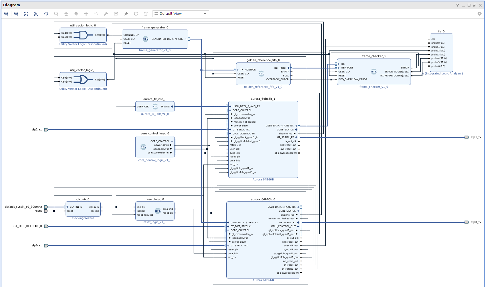

# Aurora 64B/66B SFP loopback on ZCU670

This project continues [Aurora internal loopback on ZCU670](https://github.com/mehdimoore/aurora-zcu670-loopback) as a practical learning exercise. It extends the internal-loopback simulation to a physical SFP link, introducing board clocks, reset sequencing, pin constraints and ILA debugging.

A Vivado IP Integrator project for sending framed data between two Aurora 64B/66B cores through the ZCU670's SFP0 and SFP1 connectors. A frame generator transmits through Aurora 0, a golden-reference FIFO records accepted TX words, and a checker compares Aurora 1's received data with that reference.

Both cores use normal transceiver operation (`loopback = 3'b000`). A duplex cable between SFP0 and SFP1 provides the external loopback path. Payload traffic runs from Aurora 0 to Aurora 1; Aurora 1's application TX interface is held idle.

## Block diagrams

### High-level data path

This diagram explains how the frame generator, golden-reference FIFO, two Aurora cores and frame checker work together. It shows the payload path through the external SFP cable and the reverse serial connection.



The [interactive HTML diagram](aurora_block_diagram.html) provides selectable data-path, clock/reset and simulation views. Download the repository and open the HTML file locally to select blocks and inspect their ports and connections.

### Vivado block design

This screenshot shows the actual IP Integrator blocks and wiring, including the shared logic between the Aurora cores, Clocking Wizard, reset controller, application logic and ILA.



## Configuration

| Setting | Value |
| --- | --- |
| Vivado | 2025.2 |
| Board / FPGA | ZCU670 / `xczu67dr-fsve1156-2-i` |
| Board files | `xilinx.com:zcu670:part0:2.0` |
| Aurora IP | Aurora 64B/66B 13.0 |
| Aurora endpoints | Two single-lane duplex cores |
| Serial line rate | 10.3125 Gb/s per lane |
| GTY placement | SFP0: X0Y0; SFP1: X0Y1, in quad X0Y0 / bank 127 |
| Shared logic | Inside Aurora 0; Aurora 1 reuses Aurora 0's support signals |
| AXI data / frame size | 64 bits / 16 words, or 128 bytes |
| Payload | Continuous incrementing counter; all eight bytes valid |
| Golden-reference FIFO | 256 words, including `TKEEP` and `TLAST` |
| GT reference clock | Board differential 156.25 MHz |
| Initialization clock | 100 MHz from a Clocking Wizard driven by board 300 MHz |
| Application clock | Aurora 0 `user_clk_out`, approximately 161.133 MHz |
| Debug | Native ILA, seven probes, 1024 samples |

The generator starts when both channels are up. The generator, FIFO and checker share an application reset formed by OR-ing the two cores' `sys_reset_out` signals.

## Requirements

- Vivado 2025.2 with support for the target FPGA and the listed IP.
- ZCU670 board files version 2.0 and the licenses required to build the included IP.
- For board testing: a ZCU670, JTAG connection, and SFP modules or a DAC cable compatible with the configured serial rate.

The ZCU670 board files must be available in Vivado before recreating the project. This design uses the board's differential clock and reset interfaces.

## Recreate the project

With Vivado on `PATH`, run from the repository root:

```sh
vivado -mode batch -source Scripts/build.tcl
```

The script adds the sources, recreates the twelve-block diagram, validates it, generates IP output products and the HDL wrapper, and creates the IP synthesis runs. It creates:

```text
build/aurora_zcu670_sfploopback.xpr
```

To choose a different output directory:

```sh
vivado -mode batch -source Scripts/build.tcl -tclargs /path/to/new/build
```

Use a new output directory when recreating the project. The script does not overwrite an existing project. Open the generated project in Vivado to inspect the block design, simulate, or build the hardware.

## Simulation

The simulation top is `aurora_system_tb`. It supplies differential 300 MHz and 156.25 MHz clocks, releases the board reset, and cross-connects both serial directions to model a cable between the two SFP connectors.

In Vivado, select **Run Simulation → Run Behavioral Simulation**. The simulation opens at time zero. Run this command in the simulation Tcl console:

```tcl
run 1 ms
```

The testbench checks that both channels are up, the checker error flag is clear, and at least one frame has arrived. It prints `TEST_PASS` or `TEST_FAIL` and pauses at 1 ms. Useful waveform signals under `/aurora_system_tb` are `channel_up_0`, `channel_up_1`, `checker_error` and `rx_frames`.

## Build and run on the board

1. Run **Synthesis**, **Implementation**, then **Generate Bitstream**. Check timing and DRC reports before programming.
2. Prepare the SFP0–SFP1 cable connection and enable both transmitters using the board settings described in the [connection guide](docs/aurora_connections_readme.md#sfp-connections).
3. Open Hardware Manager, connect to the target, and program the FPGA using the matching `.bit` and `.ltx` files.
4. Use ILA to check that both channels are up, application reset is low, errors and FIFO overflow are clear, and the received-frame counter increases.

Build outputs are under:

```text
build/aurora_zcu670_sfploopback.runs/impl_1/
├── aurora_system_wrapper.bit
└── aurora_system_wrapper.ltx
```

ILA is clocked by Aurora 0's user clock; captures require that clock to be running. Physical link operation and ILA captures still require board verification.

## Repository contents

| Path | Contents |
| --- | --- |
| `Scripts/build.tcl` | Portable project recreation script |
| `Sources/BD/aurora_system.tcl` | Exported block design, including IP configuration and wiring |
| `Sources/RTL/` | Six custom RTL modules |
| `Sources/Constraints/zcu670_pins.xdc` | SFP pin assignments and GT reference-clock constraints |
| `Sources/Simulation/aurora_system_tb.v` | Two-core system simulation |
| [Connection guide](docs/aurora_connections_readme.md) | Ports, clocks, resets, shared logic, ILA and board pin references |
| [Tcl commands](docs/TCL_COMMANDS.md) | Project recreation, simulation, build and report commands |

Vivado projects, generated IP products, logs, bitstreams and debug captures are excluded by `.gitignore`.
